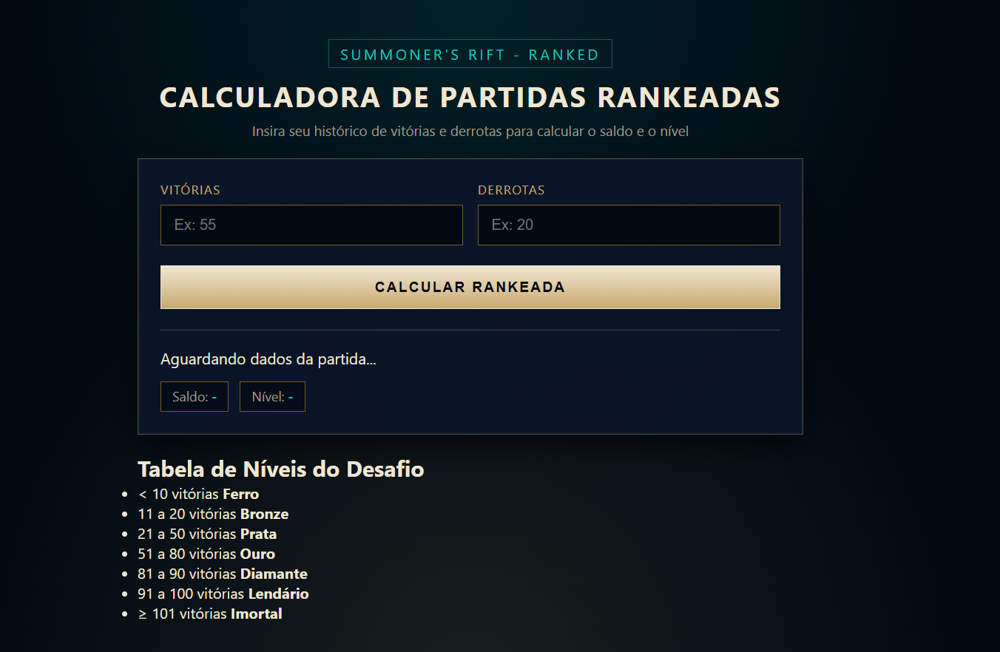

🏆 Calculadora de Partidas Rankeadas — Rift Edition

  

Uma aplicação web interativa desenvolvida como solução para o desafio Calculadora de Partidas Rankeadas da Digital Innovation One (DIO), estilizada com uma interface inspirada no universo Hextech de League of Legends.

🎯 Sobre o Projeto

O objetivo principal do desafio é praticar os fundamentos essenciais da lógica de programação criando uma função que recebe a quantidade de vitórias e derrotas de um jogador, calcula o saldo de rankeadas e classifica o nível do herói de acordo com seu desempenho.

Para elevar o projeto a nível de portfólio, além da lógica pura em JavaScript, foi construída uma interface temática com estética escura, dourado Hextech e ciano rúnico, conectando a lógica à tela por meio da manipulação do DOM.

⚙️ Regras de Classificação

O cálculo do saldo é feito pela fórmula:

$$\text{Saldo de Vitórias} = \text{Vitórias} - \text{Derrotas}$$

Já o nível do jogador é determinado pela quantidade total de vitórias:

Quantidade de Vitórias

Nível / Elo

Menor que 10 (< 10)

Ferro

Entre 11 e 20 (11 - 20)

Bronze

Entre 21 e 50 (21 - 50)

Prata

Entre 51 e 80 (51 - 80)

Ouro

Entre 81 e 90 (81 - 90)

Diamante

Entre 91 e 100 (91 - 100)

Lendário

Maior ou igual a 101 (>= 101)

Imortal

💬 Saída Esperada

Ao processar os dados, o sistema exibe a mensagem padrão exigida pelo desafio:

"O Herói tem de saldo de {saldoVitorias} está no nível de {nivel}"

🧠 Conceitos Aplicados

Variáveis e Constantes: armazenamento de referências do DOM, entradas do usuário e resultados intermediários (const, let).

Operadores: operadores aritméticos (-), relacionais (<, >=, <=) e lógicos (&&, ||).

Estruturas de Decisão: cadeia condicional if / else if / else para avaliar intervalos de vitórias e validar entradas.

Funções: código modularizado em funções com responsabilidades únicas (calculateRankedStats, renderRankedResult, runConsoleTests).

Laços de Repetição: uso de estrutura for para executar uma bateria de testes automatizados no console do navegador.

Manipulação do DOM: captura do evento submit no formulário e atualização dinâmica da interface sem recarregar a página.

📂 Estrutura de Pastas

ranked-match-calculator/
├── index.html      # Estrutura semântica da aplicação e painel de resultados
├── style.css       # Estilização temática inspirada na UI Hextech de League of Legends
├── script.js       # Lógica de cálculo, classificação, testes no console e DOM
└── README.md       # Documentação do projeto

🚀 Como Executar o Projeto

Clone este repositório (ou baixe os arquivos):

git clone https://github.com/dylanclarkl/ranked-match-calculator.git

Acesse a pasta do projeto:

cd ranked-match-calculator

Abra no navegador:

Dê um duplo clique no arquivo index.html ou utilize a extensão Live Server no VS Code.

Teste no console (opcional):

Abra o DevTools do navegador (F12 -> aba Console) para visualizar a execução automática dos cenários de teste.

👨‍💻 Autor

Desenvolvido por Dylan Clark durante o bootcamp da DIO.

Sinta-se à vontade para explorar o código, abrir issues ou sugerir melhorias!